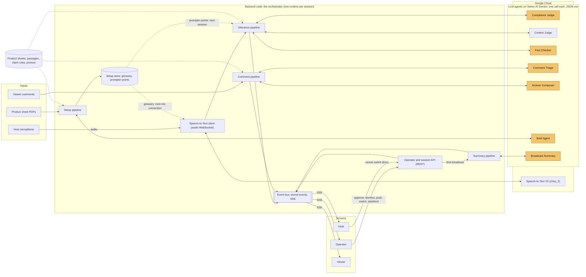
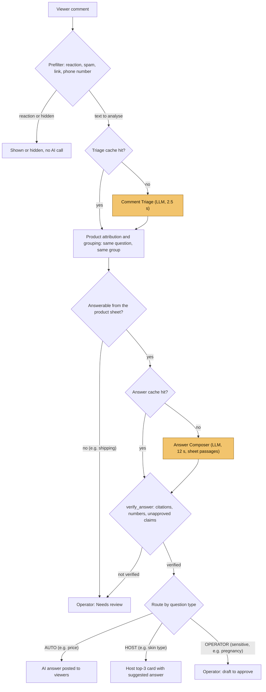
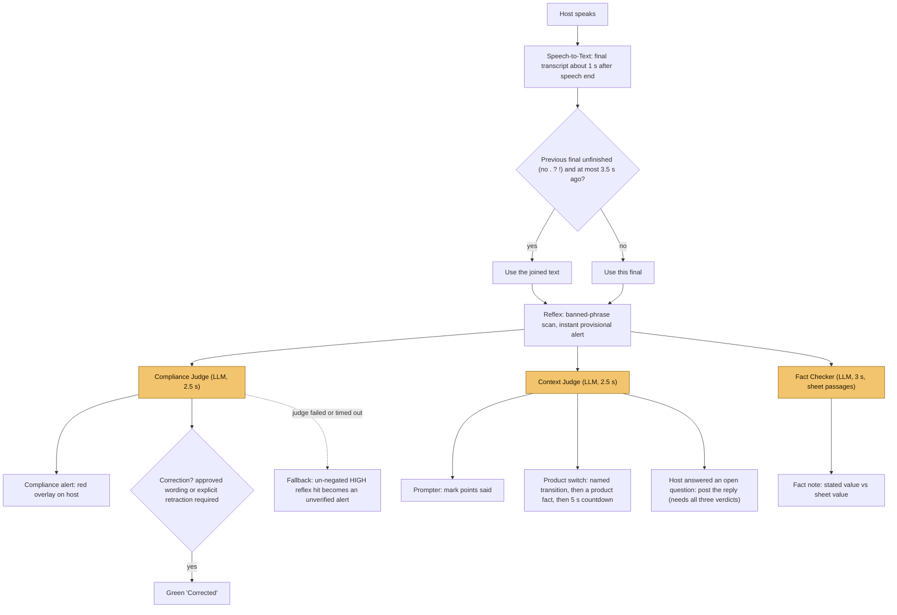
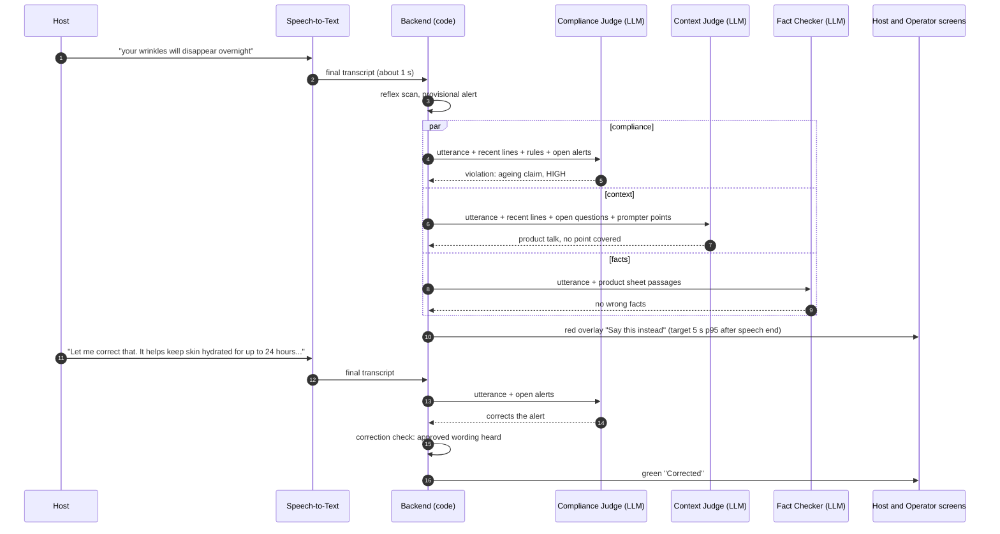
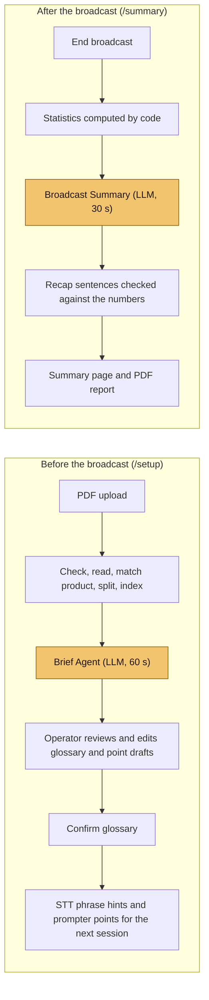

# Agent architecture

**In one sentence:** there is no main or orchestrator agent. The backend code orchestrates: an event-driven pipeline, one runtime per broadcast session. It calls six single-purpose LLM agents, each once per input. Each agent returns one JSON object checked against a schema.

| | |
|---|---|
| **Orchestration** | Backend code (FastAPI, one `SessionRuntime` per session). Every step order, retry, route and publish decision is code. |
| **Agents** | 6 single-call agents: one request, one validated JSON reply, a fixed deadline. Agents have no tools, no memory between calls and no loops, and they never call each other. |
| **Between agents** | Code passes outputs on. Examples: triage output → grouping and routing → composer input; judge output → alerts, prompter, switch. |
| **Guards** | Deterministic checks before and after the agents: prefilter, reflex, `verify_answer`, the correction check, the switch state machine, the publish decision. |

## 1. System overview

**Notes on the overview:**
- **Setup does not emit events.** It stores the confirmed glossary and prompter points. The glossary is used from the next mic connection as phrase hints, and the prompter points from the next session. `/setup` uses REST only.
- **Actions come back over REST:** operator actions (`api/operator.py`, 22 routes) and session start/end (`api/sessions.py`). Mic audio arrives over a WebSocket (`api/audio_ws.py`).
- **Google Cloud runs the speech recognition and the models.** The backend holds the code that calls them: audio relay, prompt building, schema validation, deadlines.

## 2. Comment path (viewer question → answer)

## 3. Utterance path (host speech → alerts, prompter, switch)

The Compliance Judge, the Context Judge and the Fact Checker run **in parallel** for each final (`JUDGE_MODE=split3`, D-099). Each verdict is applied the moment it arrives, so the red alert never waits for the prompter or the fact check. `JUDGE_MODE=split` puts both judges' jobs in one Utterance Judge (rollback); `single` adds the fact check to that call.

## 4. One sentence, end to end

## 5. Before and after the broadcast

## The seven agents

| Agent | Runs | Input | Output | Model, deadline | If it fails |
|---|---|---|---|---|---|
| Comment Triage | each comment (cache first) | comment, product on air, open question groups | kind, intent, product, canonical question, group to join | gemini-3.5-flash-lite (MINIMAL), 2.5 s | question goes to operator review |
| Answer Composer | each new question group (cache first) | canonical question, product sheet passages, set offers, active promo | answer, citations, grounded, needs_human | gemini-3.8-flash (LOW), 12 s | group goes to operator review |
| Compliance Judge | each final transcript | utterance (joined if split), recent lines, claim rules, approved claims, open alerts with their "say this instead" | violations (negated / quoted), corrections | gemini-3.5-flash-lite (MINIMAL), 2.5 s | reflex decides: un-negated HIGH hit becomes an unverified alert |
| Context Judge | each final transcript, in parallel | utterance (joined if split), recent lines, run sheet, open questions, prompter points, cues | answered question, points said, switch signal | gemini-3.5-flash-lite (MINIMAL), 2.5 s | prompter and switch skip that sentence; no host answer posted |
| Fact Checker | each final transcript, in parallel with the judges | utterance, retrieved sheet passages, active promo | claims: supported / contradicted with the sheet value | gemini-3.5-flash-lite (MINIMAL), 3 s | no fact note for that sentence |
| Brief Agent | /setup, per product | product sheet text | glossary terms, prompter point drafts | gemini-3.8-flash (MEDIUM), 60 s | error shown, previous result kept |
| Broadcast Summary | after "End broadcast" | statistics computed by code | headline, highlights, watch-outs, follow-ups | gemini-3.8-flash (MEDIUM), 30 s | statistics shown without a recap |

**What agents never do:**
- call each other or any tool;
- post to viewers by themselves;
- decide numbers shown on screens;
- change state directly.

Every effect goes through code that checks it first. Settings are in `.env.example`, and the decisions behind them are in `docs/DECISIONS.md`.
